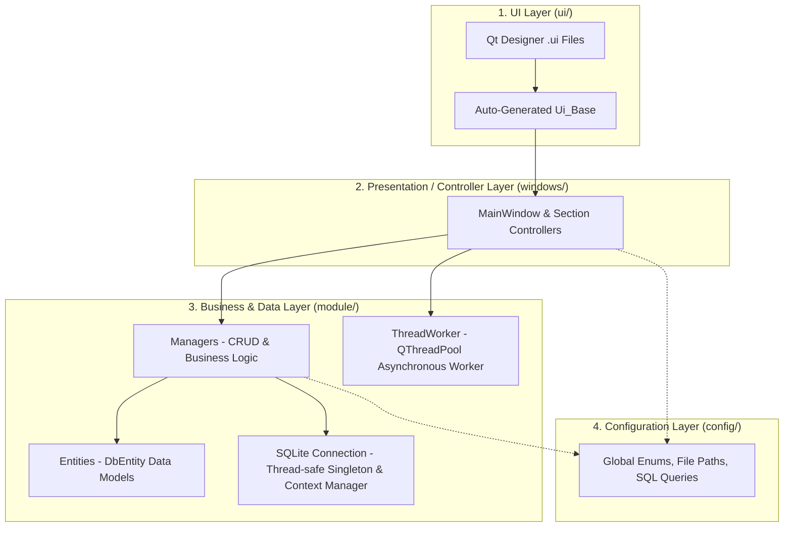

# TradeDaily 📈

[](https://github.com/meliheliguzel/trade-daily/actions/workflows/ci.yml)
[](https://github.com/meliheliguzel/trade-daily/actions/workflows/release.yml)
[](https://www.python.org/)
[-41CD52.svg)](https://wiki.qt.io/Qt_for_Python)
[](https://plotly.com/python/)
[](https://github.com/astral-sh/ruff)
[](https://docs.pytest.org/)
[](https://docs.pytest.org/)
[](#-cross-platform-build--packaging)
[](LICENSE)

> **TradeDaily** is a modern, offline-first desktop **trading journal**, **risk management**, and **portfolio analytics** application designed for disciplined financial market traders across Crypto, Forex, Equities, and Futures.

---

## 📸 Application Preview

<!-- Place your high-resolution application screenshot in docs/images/dashboard.png -->
<p align="center">
  
</p>

---

## 💡 Developer's Note: Purpose & Problems Solved

### The Problem
Consistent profitability in financial markets requires ironclad emotional discipline, mathematical risk management, and rigorous post-trade analysis. Yet, most active traders encounter significant friction with existing tools:
1. **Unstructured Spreadsheets:** Prone to manual formula corruption, time-consuming to update, lacking visual feedback, and cumbersome when managing multiple trading profiles.
2. **Subscription Cloud Journals ($30–$50 / month):** Costly recurring subscriptions that force traders to upload sensitive account balances, trade history, and strategy notes to remote third-party servers.

### The Solution: TradeDaily
**TradeDaily** was engineered to eliminate these compromises:
- **100% Offline-First & Privacy-Focused:** All trade logs, notes, balances, and chart screenshots reside strictly in local SQLite databases on your machine. Zero telemetry, zero external database dependencies, and zero monthly subscriptions.
- **Mathematical Discipline (R:R & Sizing):** Built-in position sizing and Risk/Reward calculators ensure trade parameters and capital risk allocations are calculated before entering orders.
- **Isolated Multi-Account Architecture:** Effortlessly segregate personal Spot, Futures, and Prop Firm / Funded evaluation accounts into independent profiles with dedicated databases and real-time reactive UI switching.
- **Modernized & Tested Codebase:** Originally developed as a personal trading tool and later modernized to **Python 3.12**, **Qt 6 (PySide6)**, and **Plotly 6**, the software is reinforced with an automated test suite of **237 unit and integration tests** achieving **>90% test coverage**.

Community feedback, feature discussions, and pull requests are warmly welcomed!

---

## 📌 Table of Contents
- [TradeDaily 📈](#tradedaily-)
  - [📸 Application Preview](#-application-preview)
  - [💡 Developer's Note: Purpose \& Problems Solved](#-developers-note-purpose--problems-solved)
    - [The Problem](#the-problem)
    - [The Solution: TradeDaily](#the-solution-tradedaily)
  - [📌 Table of Contents](#-table-of-contents)
  - [✨ Key Features](#-key-features)
    - [1. 📝 Disciplined Trading Journal](#1--disciplined-trading-journal)
    - [2. ⚖️ Risk / Reward (R:R) \& Position Sizing Calculator](#2-️-risk--reward-rr--position-sizing-calculator)
    - [3. 📊 Interactive Visual Analytics \& Charts](#3--interactive-visual-analytics--charts)
    - [4. 💰 Capital \& Equity Curve Tracking](#4--capital--equity-curve-tracking)
    - [5. 👥 Multi-Account \& Segregated Profiles](#5--multi-account--segregated-profiles)
    - [6. ⚡ Infinite Scroll \& Optimized Table (Lazy Loading)](#6--infinite-scroll--optimized-table-lazy-loading)
    - [7. 🛡️ Robust Architecture \& Error Handling](#7-️-robust-architecture--error-handling)
  - [🏛 Architecture \& Design Principles](#-architecture--design-principles)
  - [🛠 Tech Stack](#-tech-stack)
  - [🚀 Installation \& Quick Start](#-installation--quick-start)
    - [Prerequisites](#prerequisites)
    - [1. Clone the Repository](#1-clone-the-repository)
    - [2. Set Up Virtual Environment \& Dependencies](#2-set-up-virtual-environment--dependencies)
    - [3. Run the Application](#3-run-the-application)
  - [📦 Cross-Platform Build \& Packaging](#-cross-platform-build--packaging)
    - [Local Compilation (Native OS)](#local-compilation-native-os)
    - [Output Artifacts (`dist/` directory):](#output-artifacts-dist-directory)
  - [🗺️ Planned Future Roadmap](#️-planned-future-roadmap)
  - [🧪 Testing \& Quality Control](#-testing--quality-control)
  - [📁 Project Directory Structure](#-project-directory-structure)
  - [📄 License](#-license)
  - [⚠️ Financial \& Investment Disclaimer](#️-financial--investment-disclaimer)

---

## ✨ Key Features

### 1. 📝 Disciplined Trading Journal
- **Full Trade Lifecycle:** Log trade executions: Platform (Exchange), Trading Pair, Entry/Exit Dates, Direction (Long/Short), R:R, Position Size, Target/Stop/Exit Prices, and Net P&L.
- **Trade States:** Track Open, Take Profit (TP), and Stop Loss (SL) states with automated balance and outcome calculations.
- **Multi-Strategy Tagging:** Associate multiple strategy tags with a single transaction to accurately evaluate individual strategy win rates and profitability.
- **Permanent In-Database Chart Archiving:** Store chart screenshots directly inside the SQLite database as binary blobs (`BLOB`) or attach external web links (e.g., TradingView); preview charts natively with the built-in desktop popup viewer.
- **Dedicated Trade Notes:** Capture market context, trade psychology, and post-trade execution reviews for every trade.

### 2. ⚖️ Risk / Reward (R:R) & Position Sizing Calculator
- Instantly compute ideal position size, risk percentage, and risk-reward ratio from stop distance, risk factor (R), and leverage.
- Rapid input reset and one-click calculation pipeline.

### 3. 📊 Interactive Visual Analytics & Charts
- **Plotly & QtWebEngine Integration:** Sleek dark-mode, interactive web charts rendered natively within the desktop window:
  - Long vs. Short distribution (Pie chart).
  - TP vs. SL win-rate performance breakdown.
  - Strategy usage frequency and profitability metrics.
  - Per-trade R:R distribution and net balance impacts.
  - One-click high-resolution chart export directly to your system `Downloads` folder.

### 4. 💰 Capital & Equity Curve Tracking
- Log initial balances, deposits, withdrawals, and realized trade P&L.
- Dynamically generated balance growth curves (Equity Curve) plotting account progression over time.

### 5. 👥 Multi-Account & Segregated Profiles
- Manage segregated profiles for different accounts (e.g., Spot, Futures, Prop Firm / Funded Accounts).
- Seamless account switching directly from the top menu bar.
- Dedicated, independent SQLite database, log, and chart files per profile with instantaneous reactive UI reload.

### 6. ⚡ Infinite Scroll & Optimized Table (Lazy Loading)
- High-performance trade history viewer with lazy loading (infinite scroll) to smoothly render large transaction histories.
- Interactive State Info table: double-click filter transactions dynamically by state (`Open`, `TP`, `SL`) and direction (`Long`, `Short`).
- Chronological sorting (Newest to Oldest / Oldest to Newest) and live statistical summary bar.

### 7. 🛡️ Robust Architecture & Error Handling
- Non-intrusive status bar exception management (`@except_work`) providing clear diagnostic feedback without application crashes.
- Foreign key integrity enforcement across platforms, parities, trade details, notes, and balance records.

---

## 🏛 Architecture & Design Principles

TradeDaily strictly adheres to a decoupled **MVC (Model-View-Controller)** layered architecture:



- **Strict UI & Logic Decoupling:** UI controllers (`windows/`) never execute raw SQL directly. Instead, they interact via `module.data.manager` classes which return strongly typed entity objects.
- **Type-Safe Entity Modeling:** All database records map directly to Python dataclasses inheriting from `module.data.entities.DbEntity`.
- **Thread-Safe Singleton Database:** SQLite connection pooling and access are encapsulated via a thread-safe Singleton pattern and context managers.
- **Asynchronous Chart Generation:** Heavy operations such as Plotly HTML generation and mathematical recalculations run off the main thread via `QThreadPool` / `ThreadWorker`, ensuring zero UI stutter or freezes.

---

## 🛠 Tech Stack

- **Language:** Python 3.12+
- **GUI Framework:** [PySide6](https://wiki.qt.io/Qt_for_Python) (Qt 6: QtWidgets, QtWebEngineWidgets, QtCore)
- **Data Visualization:** [Plotly Express & Graph Objects](https://plotly.com/python/)
- **Database:** SQLite3
- **Package & Dependency Manager:** [uv](https://github.com/astral-sh/uv) / pip
- **Linter & Formatter:** [Ruff](https://github.com/astral-sh/ruff)
- **Testing:** pytest, pytest-qt, pytest-cov, pytest-mock

---

## 🚀 Installation & Quick Start

### Prerequisites
- Python 3.12 or higher
- `uv` (recommended) or standard `pip`

### 1. Clone the Repository
```bash
git clone https://github.com/meliheliguzel/trade-daily.git
cd trade-daily
```

### 2. Set Up Virtual Environment & Dependencies

**Using `uv` (Fastest):**
```bash
uv sync --all-groups
```

**Using standard `venv` & `pip`:**
```bash
python3 -m venv .venv
source .venv/bin/activate  # On Windows: .venv\Scripts\activate
pip install -e ".[dev,build]"
```

### 3. Run the Application
```bash
uv run tradedaily
# or
python main.py
```

---

## 📦 Cross-Platform Build & Packaging

TradeDaily includes a unified packaging script capable of building standalone executable bundles for **Linux**, **Windows**, and **macOS**.

### Local Compilation (Native OS)
To compile a standalone bundle on your current operating system:
```bash
# Clean build and compile standalone bundle into dist/
uv run tradedaily-build --clean

# Or build as a single-file executable
uv run tradedaily-build --onefile
```

### Output Artifacts (`dist/` directory):
- **Linux:** `dist/TradeDaily/TradeDaily` and `dist/TradeDaily.desktop`
- **Windows:** `dist/TradeDaily/TradeDaily.exe`
- **macOS:** `dist/TradeDaily.app`


## 🗺️ Planned Future Roadmap

The following enhancements are planned for subsequent releases:
- [ ] **Import & Export:** Export and import trade history to/from CSV and Excel formats.
- [ ] **Read-Only Exchange Sync:** Synchronize closed trades via read-only API keys from major exchanges (e.g., Binance, Bybit).
- [ ] **Advanced Time-Based Analytics:** Statistical performance breakdown by day of the week, market session (Asian, London, New York), and trade holding duration.
- [ ] **Theme Switcher:** Dynamic Dark / Light theme toggle.
- [ ] **Multi-Currency Accounting:** Support for balances tracked in multiple base currencies (USD, EUR, USDT, BTC).

---

## 🧪 Testing & Quality Control

TradeDaily maintains an automated test suite verifying database transactions, user settings, GUI event pipelines, and analytical calculations.

```bash
# Run all tests
uv run pytest

# Run tests with terminal coverage report
uv run pytest --cov=config --cov=module --cov=windows --cov=scripts --cov-report=term

# Run code style and linter checks
uv run ruff check
```

---

## 📁 Project Directory Structure

```plaintext
trade-daily/
├── .github/
│   └── workflows/       # GitHub Actions CI & Cross-Platform Release workflows
├── assets/              # High-resolution application logos (PNG, ICO)
├── config/              # Centralized configuration, Enums, and SQL query definitions
│   ├── query/           # SQL CREATE TABLE and analytical queries
│   ├── global_var.py    # Global paths, application timeouts, and settings
│   └── info.py          # About dialog metadata, developer note, and disclaimer
├── docs/
│   └── images/          # Application screenshots and documentation assets
├── module/              # Core business logic and background modules
│   ├── data/
│   │   ├── connection/  # SQLite connection pool (Singleton & Context Manager)
│   │   ├── entities/    # Strongly-typed database entities (Dataclasses)
│   │   ├── manager/     # Data managers and analytics data aggregators
│   │   └── settings/    # Multi-user profile and JSON settings manager
│   ├── tools/           # Chart generators (Plotly), logger, and UI helpers
│   └── utils/           # R:R calculations and asynchronous ThreadWorker
├── scripts/             # Utility controllers, table loaders, and build script
│   └── build.py         # Cross-Platform PyInstaller packaging script
├── tests/               # Comprehensive test suite (237 unit and integration tests, >90% coverage)
├── ui/                  # Generated Qt Designer UI forms
├── windows/             # Presentation / Controller layer
│   ├── main/            # Main window section controllers (Record, Display, Analysis, Accounts, etc.)
│   └── supplement/      # WebEngine viewers and Info window controller
├── TradeDaily.spec      # PyInstaller cross-platform specification
├── main.py              # Application entry point
├── pyproject.toml       # Project metadata, dependencies, scripts, and tool configurations
└── README.md            # Project documentation
```

---

## 📄 License

Distributed under the [MIT License](LICENSE). See `LICENSE` for more information.

---

## ⚠️ Financial & Investment Disclaimer

**TradeDaily** is strictly an informational record-keeping, trade journaling, and quantitative risk calculation tool. It does **not** provide investment, trading, financial, tax, or legal advice. Financial trading (Cryptocurrency, Forex, Equities, Options, and Futures) involves substantial risk of loss and is not suitable for every investor. The author and contributors assume no responsibility or liability for any financial decisions, trades, orders, or losses incurred directly or indirectly through the use of this software. Always conduct your own due diligence and consult a certified financial advisor before risking capital.
